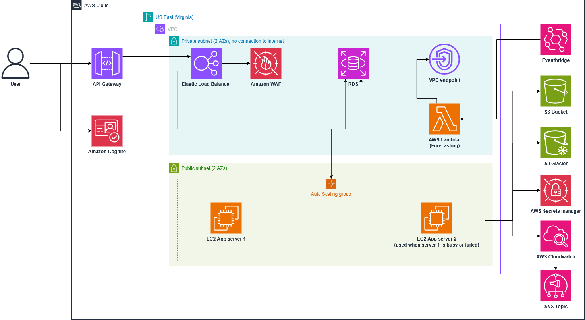

# CafeStock — stock inventory and reorder forecasting for small cafés

INF2006 Cloud Computing & Big Data · Team Project 1 · Group **TO FILL (Gxxx)**

## Problem

Small cafés run out of milk on a busy morning, or bin spoiled stock after a quiet week. Owners
usually track stock on paper or in spreadsheets and reorder by gut feel, and staff have no shared
record of what was delivered, used or wasted. **CafeStock** is a cloud web app where staff record
deliveries, usage, waste and stock counts in seconds. Every night it forecasts each ingredient's
demand and tells the manager **what to order, how much and why**: a LightGBM demand model,
checked against a moving-average baseline, turned into reorder points with safety stock.
The same app replaces the chat-message roster: the manager plans each week's shifts (who,
when, which position) without double-booking anyone, and each staff member sees only their own
shifts. Success means no stock-outs of fast movers, less waste, a forecast that is measurably
at least as good as the simple rule it replaces, and one place for the week's roster.

## Team

| Name    | Student ID | Role    |
| ------- | ---------- | ------- |
| MOHAMED RAIHAN BIN ISMAIL | 2503274 | Team Leader, Web Developer (Full Stack) |
| HO SHANG JAY | 2500526 | Web Developer, AWS Cloud Developer |
| HU SHIYAO | 2500892 | Data Analyst |
| JASON WOO | 2502583 | AWS deployment and operations lead (DevOps) |
| GOH JASON FADIL | 2502643   | Demo Video Lead, Product Requirements & Ideation |

## Quick start (offline, on a clean machine)

You need Node.js 24 (or 22.12+), Docker Desktop (running) and Python 3.12+. Open a terminal
(PowerShell, Command Prompt, macOS/Linux Terminal or the VS Code terminal) in the folder that
holds this README. Every `npm` command runs from `src/`, and each line is one command.

```bash
cd src
npm install            # installs both apps (npm workspaces)
npm run db:setup       # PostgreSQL 17 in Docker, tables, demo café
npm run db:import      # the café dataset (../data/)
npm run dev            # API on :3000 + web app on http://localhost:5173
```

Open http://localhost:5173 and choose **Continue as manager**. `npm run dev` keeps running in
that terminal; stop it with <kbd>Ctrl</kbd>+<kbd>C</kbd>. Next time, start Docker Desktop and
run only `npm run db:up` and `npm run dev`.

If the page asks for a Cognito sign-in instead, `src/backend/.env` has Cognito ids set. Add the
line `AUTH_MODE=dev` to that file and restart `npm run dev`.

Tests and the data/AI result: open a **second terminal**, `cd src`, and keep the database
running (`npm run db:up`):

```bash
npm test                  # API (with a real database) + web app
npm run forecast:setup    # once: Python environment for the forecast engine
npm run forecast:test     # forecast engine, publishing, Lambda handler
npm run analytics:setup   # once: LightGBM, numpy, pandas
npm run analytics         # model vs baseline evaluation (writes ../analytics/outputs/)
npm run analytics:test    # reproducibility checks for that evaluation
```

`tests/README.md` lists every suite and what it covers.

Deploying on AWS (optional; needs an AWS Academy Learner Lab account, about $1.90/day while
running): `src/docs/aws-deploy.md`. A marker doesn't need to deploy anything: the configuration
is in `src/infra/`, and dated evidence of the deployment is in `evidence/`.

## Architecture



- **Users and sign-in:** browser → **API Gateway** (HTTPS) → VPC link → **internal Application
  Load Balancer** with **AWS WAF** → **EC2 Auto Scaling group** (1–2 servers, two Availability
  Zones) running the Node.js API, which also serves the React web app. Users sign in with
  **Amazon Cognito** (staff and manager roles).
- **Data:** **Amazon RDS for PostgreSQL** in private subnets, with TLS on every connection. The
  password is generated and kept in **Secrets Manager**.
- **Forecast:** an **EventBridge** rule runs a **Lambda** function every night. It scores
  LightGBM against the baseline, keeps the better one, and writes forecasts and reorder advice to
  RDS. The model file lives in **S3**.
- **Operations:** **CloudWatch** logs, metrics, dashboards and alarms, with **SNS** e-mail
  alerts. Everything is defined in **CloudFormation**.

## Technology

TypeScript, React 19, Vite, TanStack Query · Node.js 24, Express 5, Prisma 7, zod ·
PostgreSQL 17 · Python 3.12/3.13, LightGBM 4.7, numpy, pandas, Jupyter · AWS: CloudFormation,
API Gateway, Elastic Load Balancing, EC2 Auto Scaling, RDS, Lambda, EventBridge, S3, Secrets
Manager, Cognito, WAF, CloudWatch, SNS · Vitest, Testing Library, Supertest, unittest ·
Docker (local database).

## What's in this ZIP

| Path                                             | Contents                                                                                                                                  |
| ------------------------------------------------ | ----------------------------------------------------------------------------------------------------------------------------------------- |
| `README.md`                                      | This file                                                                                                                                 |
| `project_manifest.yaml`                          | Machine-readable summary; every path in it exists in this ZIP                                                                             |
| `report.pdf`                                     | The report (8–12 pages)                                                                                                                   |
| `TEAM_CONTRIBUTIONS.md`, `AI_USE_DECLARATION.md` | Declarations                                                                                                                              |
| `src/`                                           | The runnable project; every `npm` command runs from here (see `src/README.md`)                                                            |
| `src/backend/`                                   | Node.js API (Express, Prisma): `src/`, `tests/`, `prisma/` (schema, migrations, seed)                                                     |
| `src/frontend/`                                  | React web app (Vite) and its tests                                                                                                        |
| `src/forecasting/`                               | Python forecast engine, nightly Lambda handler and their tests                                                                            |
| `src/infra/`                                     | CloudFormation templates: network, database, Cognito, app, forecast, artifacts                                                            |
| `src/deploy/`, `src/docker/`                     | EC2 server setup; local PostgreSQL init (`src/docker-compose.yml`)                                                                        |
| `src/docs/`                                      | Guides: complete walkthrough, testing, AWS deployment, forecast setup, Cognito, dataset, data contract                                    |
| `src/scripts/`                                   | Build, Python runner, smoke test, test recording and submission packaging                                                                 |
| `data/`                                          | The dataset, `README.md` (provenance, licence) and `DATA_DICTIONARY.md`                                                                   |
| `analytics/`                                     | Notebook, scripts, requirements, outputs, trained model, policy evaluation, tests, and how to reproduce them                              |
| `evidence/`                                      | Test records, test runs, architecture, threat map, monitoring, availability, deployment record, screenshots                               |
| `tests/`                                         | How to run every automated test suite, and the smoke test                                                                                 |

`data/` and `analytics/` exist once, at the top level as the brief requires. The code in `src/`
reads them from there (`../data`, `../analytics`), so keep the folders side by side.

## Known limitations

- **Forecast accuracy is modest.** Over 47 walk-forward weeks the 14-day moving average has
  slightly lower daily error (MASE 0.827) than LightGBM (0.855). LightGBM is better on weekly
  totals (WAPE 21.4% vs 23.4%). Each night's run keeps whichever did better on the last 8 weeks,
  and the manager sees both scores.
- **Data:** one shop's sales for one year. Recipes and deliveries are modelled, not observed
  (see `data/README.md`).
- **AWS Academy Learner Lab constraints:**
  - CloudFront isn't permitted, so API Gateway provides HTTPS, with no CDN caching.
  - IAM roles can't be created, so the broad `LabRole` is used (see
    `evidence/threat-control-map.md`, known gaps).
- **Cost-driven choices:** a single-AZ database, no NAT gateway (the app servers sit in public
  subnets and accept traffic only from the load balancer), and no automatic password rotation.
- **Not modelled:** pack sizes (orders aren't rounded to whole packs), and supplier ordering
  (the app recommends; a person orders).
- **Scheduling is planning only:** no clock-in/out or payroll, and sign-in accounts are still
  created in Cognito (the roster links to them by e-mail).
