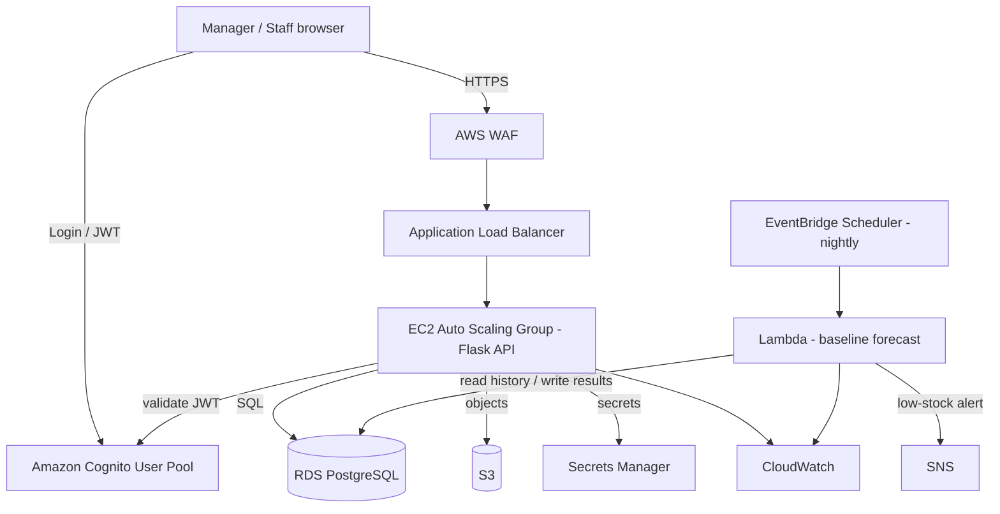

# Implementation Plan — CafeStock: Stock Inventory Management SaaS (MVP)

## Problem Statement
Build a demoable stock inventory management web application for small F&B businesses (café-style), delivered on AWS. The core is inventory CRUD (items, stock counts, suppliers). A supporting, manager-only forecasting feature displays weekly/daily demand graphs and reorder recommendations, computed by a simple statistical baseline that runs on a nightly schedule. The system is a demo MVP now but must be architected so it can grow into a production-ready, multi-tenant SaaS with minimal rework.

## Requirements
- **Roles (2):**
  - *Regular staff* — full CRUD on stock inventory (items, stock counts, receiving/adjustments, suppliers).
  - *Manager/owner* — everything staff can do, plus a read-only forecasting view (demand graphs + reorder recommendations). No IT admin role.
- **Scope (MVP):** inventory items catalog, stock counts / on-hand tracking, suppliers. Manager-only forecast view (graphs + reorder recommendations). No purchase-order generation or approval flow in the MVP (deferred).
- **Forecasting:** simple statistical baseline (moving average / exponential smoothing), run nightly, results stored in the database and read by the forecast page.
- **Multi-tenancy:** single-org for the demo, but the data model bakes in a tenant/org identifier (`org_id`) from day one so the transition to multi-tenant is low-friction.
- **Demo data:** user has a real dataset to insert; a seed/import path is needed.
- **Goal:** demoable MVP first, production-ready multi-tenant SaaS later.

## Confirmed Tech Stack (AWS)
- Frontend: **React** (SPA).
- Backend: **Flask** (Python) on **EC2** in an **Auto Scaling Group** behind an **Application Load Balancer**.
- Database: **RDS PostgreSQL** with **SQLAlchemy** ORM + **Alembic** migrations.
- Object storage: **S3** (historical logs, supplier documents, future invoice PDFs).
- Auth: **Amazon Cognito** (user pools; roles via Cognito groups → JWT claims).
- Scheduled forecasting: **EventBridge Scheduler → AWS Lambda (Python)** → writes results to RDS.
- Notifications: **SNS** (low-stock alerts).
- Observability: **CloudWatch** (logs, metrics, alarms, dashboards).
- Security: **WAF** (app-layer rules on the ALB), **IAM** (least-privilege roles, no static keys), **Secrets Manager** (DB credentials / secrets).

## Background / Research Findings
- **Reorder math (from the reference artifact):**
  - Forecast demand over lead time = sum of daily forecast across the supplier lead-time window.
  - Safety stock = Z × σ_demand × √(lead time), where Z is the service-level factor (1.65 ≈ 95% service level).
  - Reorder point = forecast demand over lead time + safety stock.
  - Shortfall / recommend = reorder point − on hand (bounded by a spoilage cap).
- **Baseline forecast:** moving average / simple exponential smoothing over trailing 14+ days of daily demand produces the 7-day forecast and the σ needed for safety stock. No ML service required.
- **Cognito roles:** Cognito groups ("staff", "manager") surface as a JWT claim. Flask validates the JWT against the pool JWKS and authorizes endpoints by group. A tenant claim can be added later for multi-tenant isolation without re-architecting auth.
- **Multi-tenant-ready data model:** every business table carries an `org_id` (FK to `organizations`). The demo seeds one org; enabling multiple orgs later scopes queries by the token's tenant claim — no schema migration of core tables.
- **Scheduling fit:** EventBridge Scheduler → Lambda is decoupled from the Auto Scaling Group (survives instance replacement) and is independently monitorable in CloudWatch — a better fit than an EC2 cron.
- **Database choice:** RDS PostgreSQL + SQLAlchemy retained. Data is highly relational; DynamoDB was rejected for primary data. Use Postgres JSONB for any semi-structured fields; consider Redis/ElastiCache as a caching layer only after the MVP.

## Proposed Solution (Architecture)

Request flow: browser authenticates against Cognito, receives a JWT (carrying the user's group). Requests hit WAF → ALB → Flask on EC2. Flask validates the JWT, authorizes by group, and scopes all data access by `org_id`. Nightly, EventBridge triggers the Lambda, which computes the baseline forecast + reorder metrics per item and writes them to RDS; the manager's forecast page reads those precomputed rows.

### Core Data Model (all business tables carry `org_id`)
- `organizations` — tenant root (single row for the demo).
- `users` — mirrors Cognito subject, links to org + role/group.
- `suppliers` — name, lead time (days), contact.
- `items` — name, unit, category, supplier_id, unit cost, reorder point, spoilage cap.
- `stock_counts` / `inventory_movements` — on-hand quantities and adjustments over time (source of daily demand history).
- `demand_history` — per-item daily demand (from movements and/or imported dataset).
- `forecasts` — per-item forecast run: date, horizon values, forecast error (MAPE), model tag, run timestamp.
- `reorder_recommendations` — per-item reorder point, safety stock, shortfall, recommended qty, status.

## Task Breakdown

- [ ] **Task 1: Project skeleton + local run + tooling.**
  Stand up Flask backend + React (Vite) frontend running locally and talking via a health endpoint. Set up virtualenv/deps (Flask, SQLAlchemy, pytest), linting/formatting, pytest harness.
  Tests: `GET /health` returns 200; frontend renders and calls `/health`.
  Demo: run both locally; React page shows "API healthy".

- [ ] **Task 2: Database schema + migrations + org scaffolding (multi-tenant-ready).**
  Define SQLAlchemy models for all core tables with `org_id` on every business table; wire Alembic migrations; connect to local Postgres; seed one demo organization.
  Tests: migration applies cleanly; models CRUD round-trip; business tables reject rows without a valid `org_id`.
  Demo: run migrations, show tables + seeded org row.

- [ ] **Task 3: Suppliers CRUD (first vertical slice, end to end).**
  Supplier CRUD API (org-scoped) + React suppliers page. Establishes the request→DB→UI pattern.
  Tests: CRUD ops incl. org-scoping (cannot read another org's suppliers); frontend list renders from API.
  Demo: add, edit, delete a supplier in the browser.

- [ ] **Task 4: Items catalog CRUD.**
  Item CRUD API + React items page (unit, category, supplier link, unit cost, reorder point, spoilage cap).
  Tests: CRUD + validation (item must reference a supplier in the same org); UI form validation.
  Demo: create items linked to suppliers and view them in a table.

- [ ] **Task 5: Stock counts / on-hand tracking + inventory movements.**
  Endpoints to record counts/adjustments, updating on-hand and appending to `inventory_movements` / `demand_history`. React page to enter a count and view on-hand per item.
  Tests: recording a count updates on-hand and writes a movement/demand row; history accrues correctly.
  Demo: perform a stock count and watch on-hand and history update.

- [ ] **Task 6: Authentication with Cognito + role-based authorization.**
  Integrate Cognito user pool with groups "staff" and "manager". Flask middleware validates JWTs against the pool JWKS, extracts group, enforces authorization; React handles login and sends the token. Gate forecast routes to managers; keep inventory CRUD open to both roles.
  Tests: manager token reaches manager-only route; staff token gets 403; invalid/expired token gets 401; data access org-scoped from token.
  Demo: log in as staff (CRUD works, forecast 403) and as manager (everything visible).

- [ ] **Task 7: Dataset import + demand history seeding.**
  Import path for the existing dataset into `demand_history` (and items/suppliers as needed), org-scoped. Documented, repeatable import command.
  Tests: import produces expected row counts and per-item daily series; re-running is idempotent or clearly versioned.
  Demo: run the import, then show populated demand history per item.

- [ ] **Task 8: Baseline forecast engine (standalone library, test-first).**
  Implement forecasting/reorder logic as a well-tested module (no AWS yet): moving-average / exponential-smoothing 7-day forecast, σ estimation, safety stock (Z × σ × √lead time), reorder point, shortfall, recommended qty (bounded by spoilage cap), forecast error (MAPE vs. baseline).
  Tests: known inputs → expected outputs matching the reorder formulas; edge cases (sparse history, zero demand).
  Demo: run the module against imported data and print a per-item recommendation table.

- [ ] **Task 9: Manager-only forecast view (graphs + recommendations).**
  Manager-only API endpoints reading `forecasts` and `reorder_recommendations`; React forecast page rendering: KPI header (items to order, 7-day MAPE, model tag, run time), per-item table (on hand, cover days, trend sparkline, recommend, status), "how this number was reached" breakdown, and observed+forecast demand chart with confidence band. Wire Task 8's engine to write results via a runnable command.
  Tests: endpoints return org-scoped, manager-only data (staff 403); UI renders graphs from seeded results.
  Demo: manager opens the forecast page and sees graphs and reorder recommendations from the imported dataset.

- [ ] **Task 10: Nightly scheduling — EventBridge Scheduler → Lambda.**
  Package the Task 8 engine as a Python Lambda that reads history from RDS, computes results, writes to `forecasts` / `reorder_recommendations`; schedule nightly with EventBridge Scheduler; publish a low-stock summary via SNS. Locally testable via a handler entrypoint.
  Tests: Lambda handler test (mocked/local DB) produces and persists results; scheduling config validated.
  Demo: invoke the Lambda (or wait for the schedule); forecast page reflects a fresh run + low-stock notification.

- [ ] **Task 11: AWS deployment — VPC, RDS, EC2/ASG, ALB, WAF, Cognito, Secrets Manager, IAM, CloudWatch.**
  Provision the environment (IaC — CloudFormation or Terraform): VPC/subnets, RDS Postgres, EC2 launch template + Auto Scaling Group running Flask, ALB with WAF, Cognito user pool + groups, Secrets Manager for DB creds, least-privilege IAM roles (EC2 and Lambda), CloudWatch log groups/alarms. Deploy backend, frontend, Lambda + schedule.
  Tests: post-deploy smoke tests (health via ALB, Cognito login, one CRUD op, forecast page loads); alarms fire on induced errors.
  Demo: full app running on AWS end to end — staff and manager logins, inventory CRUD, and the nightly-driven forecast view — behind ALB/WAF.

- [ ] **Task 12: Documentation + demo runbook + multi-tenant migration notes.**
  Setup/run/deploy docs, a demo script, and a short "path to multi-tenant SaaS" note (how `org_id` + a Cognito tenant claim scale up, and where POs/approvals would slot in later).
  Tests: a fresh follower can run the demo from the docs.
  Demo: hand the runbook to a teammate and have them reproduce the demo.

## Deferred / Out of Scope (MVP)
- Purchase-order generation and manager approve/reject flow (would slot in after Task 9 as its own vertical slice).
- Redis/ElastiCache caching layer (consider post-MVP if forecast reads need to be faster).
- IT admin role.
