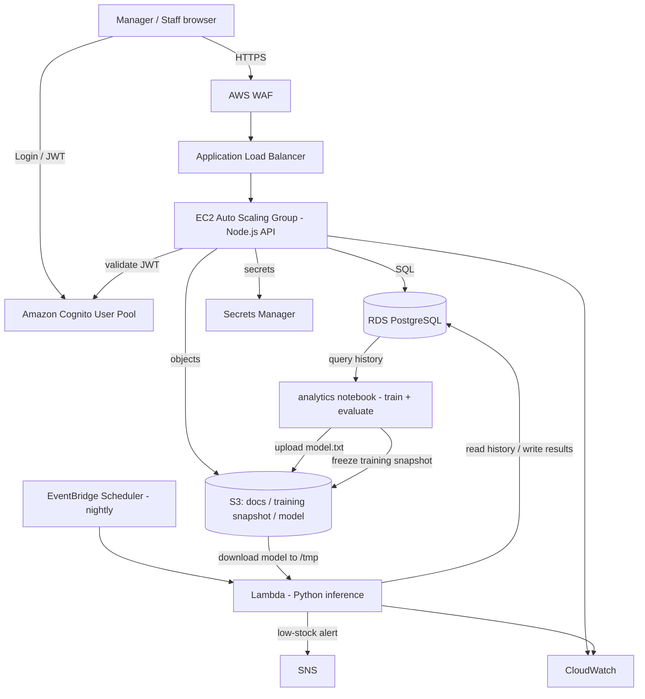

# Implementation Plan — CafeStock: Stock Inventory Management SaaS (MVP)

## Problem Statement
Build a demoable stock inventory management web application for small F&B businesses (café-style), delivered on AWS. The core is inventory CRUD (items, stock counts, suppliers). A supporting, manager-only forecasting feature displays weekly/daily demand graphs and reorder recommendations. The forecast is produced by a trained machine-learning model (LightGBM), evaluated against a simple statistical baseline, and refreshed on a nightly schedule. The system is a demo MVP now but must be architected so it can grow into a production-ready, multi-tenant SaaS with minimal rework.

## Requirements
- **Roles (2):**
  - *Regular staff* — full CRUD on stock inventory (items, stock counts, receiving/adjustments, suppliers).
  - *Manager/owner* — everything staff can do, plus a read-only forecasting view (demand graphs + reorder recommendations). No IT admin role.
- **Scope (MVP):** inventory items catalog, stock counts / on-hand tracking, suppliers. Manager-only forecast view (graphs + reorder recommendations). No purchase-order generation or approval flow in the MVP (deferred).
- **Forecasting / Data-AI feature:** a trained **LightGBM** demand-forecasting model is the assessed data/AI capability. A **moving-average / exponential-smoothing baseline** is retained as the evaluation comparison point and as a runtime fallback. Forecast results are stored in the database and read by the forecast page.
- **Multi-tenancy:** single-org for the demo, but the data model bakes in a tenant/org identifier (`org_id`) from day one so the transition to multi-tenant is low-friction.
- **Demo data:** user has a real dataset (long daily history per item) to insert; a seed/import path is needed.
- **Goal:** demoable MVP first, production-ready multi-tenant SaaS later.

## Confirmed Tech Stack (AWS)
- Frontend: **React** (SPA).
- Backend: **Node.js** (Express, TypeScript) on **EC2** in an **Auto Scaling Group** behind an **Application Load Balancer**.
- Database: **RDS PostgreSQL** with **Prisma** ORM + migrations (Node API). The Python forecast Lambda uses SQLAlchemy or psycopg2 for its DB access.
- Object storage: **S3** — supplier documents / historical logs, the **dated training-data snapshot** (dataset provenance), and the **serialized trained model artifact** (e.g., `models/lgbm-v3/model.txt`).
- ML training/evaluation: **reproducible notebook** (Colab or local) under `analytics/` — trains LightGBM, evaluates MAPE vs. baseline, exports the model to S3.
- Auth: **Amazon Cognito** (user pools; roles via Cognito groups → JWT claims).
- Scheduled forecasting (inference): **EventBridge Scheduler → AWS Lambda (Python)** → loads model from S3, reads history from RDS, writes results to RDS.
- Notifications: **SNS** (low-stock alerts).
- Observability: **CloudWatch** (logs, metrics, alarms, dashboards).
- Security: **WAF** (app-layer rules on the ALB), **Secrets Manager** (DB credentials / secrets).
- **AWS access model (Learner Lab constraint):** custom IAM users/roles/policies cannot be authored in the AWS Academy Learner Lab. The lab-provided **`LabRole`** is attached to EC2 and Lambda to grant access to RDS, S3, SNS, and Secrets Manager. Designing least-privilege custom IAM roles is deferred to the future production build.

## Language / Runtime Note (Node API + Python forecast Lambda + notebook)
This build intentionally uses two runtimes:
- **Node.js (TypeScript)** for the web API — unifies the language with the React frontend, enables shared types and validation, and fits the I/O-bound CRUD workload.
- **Python** for the ML training notebook and the nightly forecast Lambda — Python's numpy/pandas/LightGBM ecosystem is the right fit for feature engineering, training, and inference.

The two runtimes do not share a code module. The forecast/ML logic lives entirely in the Python notebook (training) and Python Lambda (inference); the Node API only **reads precomputed results** from RDS (`forecasts`, `reorder_recommendations`). The contract between them is the database schema, documented in Task 2 and Task 9.

## ML Data & Model Flow (S3 + Lambda)
Two distinct artifacts with distinct homes:
- **Training data** — source of truth is RDS (`demand_history`). For reproducibility/provenance, the notebook also freezes a **dated, immutable snapshot** to S3 (e.g., `s3://<bucket>/training-data/demand_<date>.csv`).
- **Trained model** — the serialized LightGBM file produced by the notebook lives in S3 under a versioned key (e.g., `s3://<bucket>/models/lgbm-v3/model.txt`). The version tag (e.g., `lgbm-v3`) is surfaced in the forecast UI.

Training phase (notebook, offline, occasional): pull demand history from RDS (or the frozen S3 snapshot) → feature engineering (lags, rolling means, day-of-week, trend) → train LightGBM → evaluate MAPE vs. moving-average baseline, capture feature importance and limitations → serialize model → upload to S3 under a versioned key.

Inference phase (nightly Lambda, automated): EventBridge triggers the Lambda → Lambda downloads the model file from S3 into `/tmp` (via boto3) and loads it with LightGBM → reads recent demand history from RDS → runs inference (7-day forecast, reorder point, recommended qty) → writes results to RDS (`forecasts`, `reorder_recommendations`). If the model file is missing/unreadable, the Lambda falls back to the moving-average baseline. Access to S3 and RDS is granted by the `LabRole` attached to the Lambda (no static keys).

Packaging caveat: LightGBM + numpy can exceed the standard Lambda zip size limit; package the Lambda as a **container image** (up to 10 GB) or use a **Lambda layer** for the heavy libraries. This affects packaging only, not the architecture.

## Background / Research Findings
- **Reorder math (from the reference artifact):**
  - Forecast demand over lead time = sum of daily forecast across the supplier lead-time window.
  - Safety stock = Z × σ_demand × √(lead time), where Z is the service-level factor (1.65 ≈ 95% service level).
  - Reorder point = forecast demand over lead time + safety stock.
  - Shortfall / recommend = reorder point − on hand (bounded by a spoilage cap).
- **Model vs. baseline:** the reference artifact shows a `lgbm-v3` model with "16.4% MAPE vs baseline 24.1%", i.e., a trained LightGBM model evaluated against a moving-average baseline — the exact comparison this plan reproduces.
- **Baseline forecast:** moving average / simple exponential smoothing over trailing 14+ days of daily demand produces a comparison forecast and the σ needed for safety stock; also serves as the Lambda's fallback when the model is unavailable.
- **Cognito roles:** Cognito groups ("staff", "manager") surface as a JWT claim. The Node API validates the JWT against the pool JWKS and authorizes endpoints by group. A tenant claim can be added later for multi-tenant isolation without re-architecting auth.
- **Multi-tenant-ready data model:** every business table carries an `org_id` (FK to `organizations`). The demo seeds one org; enabling multiple orgs later scopes queries by the token's tenant claim — no schema migration of core tables.
- **Scheduling fit:** EventBridge Scheduler → Lambda is decoupled from the Auto Scaling Group (survives instance replacement) and is independently monitorable in CloudWatch — a better fit than an EC2 cron.
- **Database choice:** RDS PostgreSQL retained. Data is highly relational; DynamoDB was rejected for primary data. Use Postgres JSONB for any semi-structured fields; consider Redis/ElastiCache as a caching layer only after the MVP.

## Proposed Solution (Architecture)

Note on access: EC2 (Node API) and the Lambda both run under the Learner Lab's pre-provisioned `LabRole`, which grants their access to RDS, S3, SNS, and Secrets Manager.

Request flow: browser authenticates against Cognito, receives a JWT (carrying the user's group). Requests hit WAF → ALB → Node.js API on EC2. The API validates the JWT, authorizes by group, and scopes all data access by `org_id`. Nightly, EventBridge triggers the Python Lambda, which loads the LightGBM model from S3, reads recent history from RDS, computes forecasts + reorder metrics per item, and writes them to RDS; the manager's forecast page reads those precomputed rows.

### Core Data Model (all business tables carry `org_id`)
- `organizations` — tenant root (single row for the demo).
- `users` — mirrors Cognito subject, links to org + role/group.
- `suppliers` — name, lead time (days), contact.
- `items` — name, unit, category, supplier_id, unit cost, reorder point, spoilage cap.
- `stock_counts` / `inventory_movements` — on-hand quantities and adjustments over time (source of daily demand history).
- `demand_history` — per-item daily demand (from movements and/or imported dataset).
- `forecasts` — per-item forecast run: date, horizon values, forecast error (MAPE), model tag (e.g., `lgbm-v3`), run timestamp.
- `reorder_recommendations` — per-item reorder point, safety stock, shortfall, recommended qty, status.

## Task Breakdown

- [ ] **Task 1: Project skeleton + local run + tooling.**
  Stand up Node.js (Express, TypeScript) backend + React (Vite) frontend running locally and talking via a health endpoint. Set up Node deps (Express, Prisma, a test runner such as Jest or Vitest), linting/formatting (ESLint + Prettier), and a test harness.
  Tests: `GET /health` returns 200; frontend renders and calls `/health`.
  Demo: run both locally; React page shows "API healthy".

- [ ] **Task 2: Database schema + migrations + org scaffolding (multi-tenant-ready).**
  Define the Prisma schema for all core tables with `org_id` on every business table; wire Prisma migrations; connect to local Postgres; seed one demo organization. Document the `forecasts` / `reorder_recommendations` tables (including the `model tag` field) as the contract the Python Lambda writes to.
  Tests: migration applies cleanly; models CRUD round-trip; business tables reject rows without a valid `org_id`.
  Demo: run migrations, show tables + seeded org row.

- [ ] **Task 3: Suppliers CRUD (first vertical slice, end to end).**
  Supplier CRUD API (org-scoped) + React suppliers page. Establishes the request→DB→UI pattern.
  Tests: CRUD ops incl. org-scoping (cannot read another org's suppliers); frontend list renders from API.
  Demo: add, edit, delete a supplier in the browser.

- [ ] **Task 4: Items catalog CRUD.**
  Item CRUD API + React items page (unit, category, supplier link, unit cost, reorder point, spoilage cap).
  Tests: CRUD + validation (item must reference a supplier in the same org); UI form validation.
  Demo: create items linked to suppliers and view them in a table.

- [ ] **Task 5: Stock counts / on-hand tracking + inventory movements.**
  Endpoints to record counts/adjustments, updating on-hand and appending to `inventory_movements` / `demand_history`. React page to enter a count and view on-hand per item.
  Tests: recording a count updates on-hand and writes a movement/demand row; history accrues correctly.
  Demo: perform a stock count and watch on-hand and history update.

- [ ] **Task 6: Authentication with Cognito + role-based authorization.**
  Integrate Cognito user pool with groups "staff" and "manager". Node middleware validates JWTs against the pool JWKS, extracts group, enforces authorization; React handles login and sends the token. Gate forecast routes to managers; keep inventory CRUD open to both roles.
  Tests: manager token reaches manager-only route; staff token gets 403; invalid/expired token gets 401; data access org-scoped from token.
  Demo: log in as staff (CRUD works, forecast 403) and as manager (everything visible).

- [ ] **Task 7: Dataset import + demand history seeding.**
  Import path for the existing dataset into `demand_history` (and items/suppliers as needed), org-scoped. Documented, repeatable import command. Record dataset provenance (source, fields, size, date range).
  Tests: import produces expected row counts and per-item daily series; re-running is idempotent or clearly versioned.
  Demo: run the import, then show populated demand history per item.

- [ ] **Task 8: Baseline forecast engine (standalone Python library, test-first).**
  Implement the reorder/baseline logic as a well-tested Python module (no AWS yet): moving-average / exponential-smoothing 7-day forecast, σ estimation, safety stock (Z × σ × √lead time), reorder point, shortfall, recommended qty (bounded by spoilage cap), forecast error (MAPE). This module is both the evaluation baseline and the Lambda's fallback when the ML model is unavailable. The Node API does not import it and only reads persisted output.
  Tests: known inputs → expected outputs matching the reorder formulas; edge cases (sparse history, zero demand).
  Demo: run the module against imported data and print a per-item recommendation table.

- [ ] **Task 8b: ML model training + evaluation notebook (`analytics/`).**
  Reproducible Python notebook (Colab or local): pull demand history from RDS (or a frozen S3 snapshot), feature-engineer (lags, rolling means, day-of-week, trend), train a **LightGBM** demand model, and evaluate it against the Task 8 moving-average baseline. Produce: MAPE per item (model vs. baseline), feature importance, example inputs/outputs, dataset provenance, and a limitations section. Freeze a dated training-data snapshot to S3 and export the serialized model to S3 under a versioned key (e.g., `models/lgbm-v3/model.txt`). Include a short `analytics/README` explaining how to reproduce results.
  Tests: notebook runs end to end on the snapshot and reproduces the reported metrics; model file and snapshot land in S3 (or a local mock) as expected.
  Demo: run the notebook and show the model beating the baseline on MAPE, plus the exported model artifact.

- [ ] **Task 9: Manager-only forecast view (graphs + recommendations).**
  Manager-only Node API endpoints reading `forecasts` and `reorder_recommendations`; React forecast page rendering: KPI header (items to order, model-vs-baseline MAPE, model tag e.g. `lgbm-v3`, run time), per-item table (on hand, cover days, trend sparkline, recommend, status), "how this number was reached" breakdown, and observed+forecast demand chart with confidence band. Populate the tables via a runnable command (Task 8 baseline and/or Task 8b model output) so the page has data.
  Tests: endpoints return org-scoped, manager-only data (staff 403); UI renders graphs and the model-vs-baseline MAPE from seeded results.
  Demo: manager opens the forecast page and sees graphs, the model tag, and reorder recommendations from the imported dataset.

- [ ] **Task 10: Nightly scheduling — EventBridge Scheduler → Python inference Lambda.**
  Package a Python Lambda that downloads the LightGBM model from S3 into `/tmp`, loads it, reads recent history from RDS, computes results, and writes to `forecasts` / `reorder_recommendations`; falls back to the Task 8 baseline if the model is missing. Schedule nightly with EventBridge Scheduler; publish a low-stock summary via SNS. Package the Lambda as a container image or with a layer to accommodate LightGBM/numpy size. Locally testable via a handler entrypoint.
  Tests: Lambda handler test (mocked/local DB + mocked S3) produces and persists results; baseline-fallback path tested; scheduling config validated.
  Demo: invoke the Lambda (or wait for the schedule); forecast page reflects a fresh model-driven run + low-stock notification.

- [ ] **Task 11: AWS deployment — VPC, RDS, EC2/ASG, ALB, WAF, Cognito, Secrets Manager, S3, CloudWatch.**
  Provision the environment (IaC — CloudFormation or Terraform): VPC/subnets, RDS Postgres, EC2 launch template + Auto Scaling Group running the Node.js API, ALB with WAF, Cognito user pool + groups, S3 bucket (docs / training snapshot / model), Secrets Manager for DB creds, CloudWatch log groups/alarms. Attach the Learner Lab's pre-provisioned `LabRole` to EC2 and the Lambda (custom IAM roles are not authorable in the lab). Deploy backend, frontend, model to S3, Lambda + schedule.
  Tests: post-deploy smoke tests (health via ALB, Cognito login, one CRUD op, forecast page loads, Lambda loads model from S3); alarms fire on induced errors.
  Demo: full app running on AWS end to end — staff and manager logins, inventory CRUD, and the nightly model-driven forecast view — behind ALB/WAF.

- [ ] **Task 12: Documentation + demo runbook + multi-tenant migration notes.**
  Setup/run/deploy docs, a demo script, the `analytics/` reproduction guide, and a short "path to multi-tenant SaaS" note (how `org_id` + a Cognito tenant claim scale up, where POs/approvals and anomaly detection would slot in later, and the plan to introduce least-privilege custom IAM roles once outside the Learner Lab).
  Tests: a fresh follower can run the demo and reproduce the model evaluation from the docs.
  Demo: hand the runbook to a teammate and have them reproduce the demo and the model-vs-baseline result.

## Deferred / Out of Scope (MVP)
- **Anomaly detection** on stock movements (unusual consumption / shrinkage) — planned optional second data/AI feature, reusing the same demand-history dataset.
- Purchase-order generation and manager approve/reject flow (would slot in after Task 9 as its own vertical slice).
- Redis/ElastiCache caching layer (consider post-MVP if forecast reads need to be faster).
- Hosted model inference via SageMaker / Amazon Forecast endpoints (S3-model-in-Lambda chosen instead for cost/simplicity).
- IT admin role.
- Custom least-privilege IAM roles/policies (not authorable in the AWS Academy Learner Lab; the provided `LabRole` is used instead — revisit for the production build).
