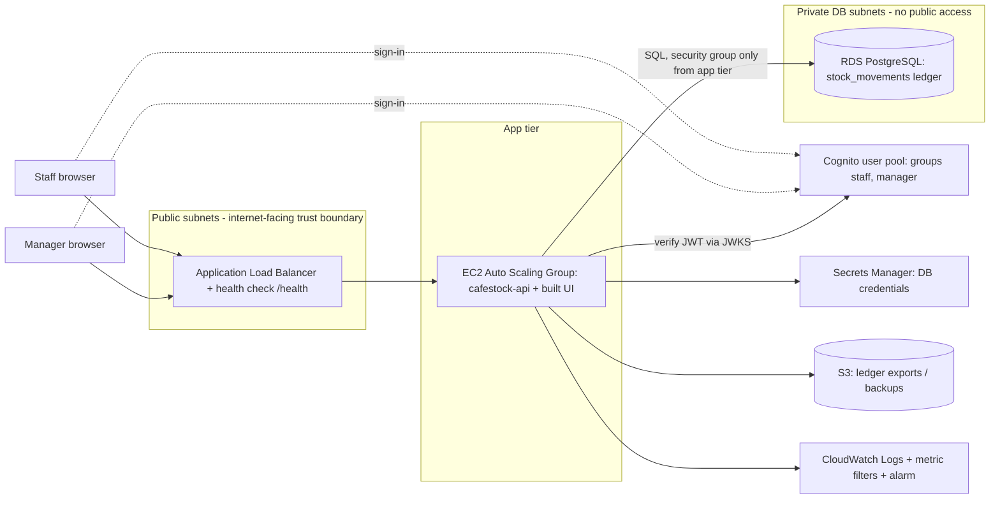

# CafeStock — Implementation Plan and Handoff

> **This file is the single source of truth for project context.** It supersedes the earlier plan that
> assumed LightGBM, multi-tenancy, Prisma and a Flask/Python backend (recoverable from git history). Those
> decisions were changed on purpose; see [Decisions log](#3-decisions-log).
>
> **If you are an AI coding agent:** read this whole file first, then `src/backend/README.md`,
> `src/frontend/README.md` and `project-requirements.md`. Run the checks in [section 9](#9-setup-run-and-test),
> then take the next unchecked work package in [section 12](#12-remaining-work-plan). When you finish a
> package, update the status tables in sections 1 and 12 in the same commit. Follow [section 11](#11-conventions-and-gotchas).

Last updated: 2026-09-30. **Submission deadline: Sunday 11 October 2026, 11:59 PM.**

---

## 1. Status snapshot

| Area | State |
|---|---|
| Ledger schema, rules, API | **Done.** Postgres, append-only ledger, DB-enforced invariants, read endpoints for catalogue/stock/movements/recommendations, and `POST /movements`. |
| Authentication and roles | **Done locally.** JWT with `staff` / `manager`; local token source tested, **Cognito source written but never run against a real user pool**. |
| Web UI | **Done.** Sign-in, stock table, movement form, movement history, manager-only Reorder plan. |
| Analytics feature | **Done in the app** (published moving-average forecast, order recomputed on live stock). **`analytics/` folder not yet in repo** (see WP2). |
| Automated tests | Backend **91** (7 files), frontend **31** (5 files). All passing; lint, typecheck, build clean. |
| Cloud deployment | **Not started.** |
| Scalability/resilience mechanism | **Not started** (DB-level concurrency control exists and is tested; that alone is not enough, see 12). |
| Monitoring | Structured JSON logs exist; no CloudWatch yet. |
| Submission package | **Mostly missing**: manifest, README, `evidence/`, `analytics/`, root `tests/`, report, declarations. |

Everything runs **locally only**. Nothing is deployed.

### What works today (demo script)

1. Start Postgres, API and UI ([section 9](#9-setup-run-and-test)); mint a token with `npm run --silent token -- manager`.
2. Sign in by pasting the token. The stock table shows 8 items; 3 are below their reorder level; 4 hold stock past its expiry date.
3. Record a sale, receive a delivery, try to oversell (refused with "Only N in stock").
4. As a manager, write off spoilage against a named batch; as staff those options are disabled and the API returns 403.
5. Open **Reorder plan** (manager only): suggested orders in whole packs, recomputed from live stock; receive stock and watch the suggestion fall.

---

## 2. Project summary

**Problem.** Small F&B businesses lack a reliable view of stock, causing stockouts, spoilage and "phantom stock".
CafeStock gives a single-location café one source of truth: an **immutable stock-movement ledger** (current stock is
always derived, never overwritten), batch and expiry tracking, and a simple interpretable reorder recommendation.

**Users and roles.**
- `staff`: read everything; record `RECEIVE` and `SELL` movements.
- `manager`: everything staff can, plus `SPOILAGE` write-offs, `ADJUST` stocktake corrections, and the Reorder plan.

**Scope (MVP, single location).** Products, suppliers, ledger, batches/expiry, low-stock flags, reorder plan.

**Explicit non-goals** (from `project-requirements.md` §8, also the team's decision): multi-location/region, event
sourcing/CQRS, real-time push, recipe-based ingredient deduction (the dataset's recipes are used only to build demo
data), trained/custom ML models, purchase-order workflow, multi-tenancy.

**Course context.** INF2006 Cloud Computing and Big Data, Team Project 1. The assessed brief is summarised in
[section 4](#4-the-brief-what-is-assessed). The brief PDF itself is not in the repo.

**Team.** Roster, student IDs and roles are **not recorded anywhere yet** (needed for the manifest and
`TEAM_CONTRIBUTIONS.md`). GitHub handles seen on earlier PRs: `r4ihn`, `husyGIT`, `HoShangJ`, `NautilusIX`,
`jaecodess`. The data/analytics work was done by another member (`husyGIT` opened the PR that added it).

---

## 3. Decisions log

| # | Decision | Why | Changed from earlier plan? |
|---|---|---|---|
| D1 | Stock is an **append-only ledger**; current stock = `SUM(quantity)` | Required by the team requirements doc (§1, §5); avoids lost updates and gives an audit trail | Yes (plan had mutable `stock_counts`) |
| D2 | Rules enforced **in Postgres** (triggers/constraints), not only in app code | Holds for any writer; evidence for "concurrency control" | New |
| D3 | Plain SQL migrations + `pg`, no ORM | Ledger rules, locking and views are clearer and more inspectable as SQL; fewer moving parts | Yes (plan said Prisma) |
| D4 | One JWT verifier, **two token sources** selected by `AUTH_MODE` (`local` \| `cognito`), no default | Marker can reproduce the security test offline (brief forbids needing a cloud login); identical claims so the cloud path is the same code | New |
| D5 | Manager-only: `SPOILAGE`, `ADJUST`, Reorder plan | Gives roles real meaning so the security test is meaningful | New |
| D6 | Forecast = **moving average (MA-2)** from the analytics work; **no ML model** | Requirements §8 says MA is sufficient; data team's backtest shows it is marginally better than naive; interpretable | Yes (plan had LightGBM) |
| D7 | Forecast and safety stock stored **as published**; the **order quantity is recomputed against live stock** with the same rule | Keeps the page correct after new movements; the rule is validated against the team's CSV in a test | New |
| D8 | **Drop multi-tenancy** (`org_id`) | Single location per requirements; adds cost to every query/test | Yes |
| D9 | Server sets `occurred_at`, `source='app'`, `recorded_by`; clients cannot back-date or forge provenance | Ledger integrity and audit | New |
| D10 | Frontend keeps token in `sessionStorage`; UI hides forbidden actions but the API enforces them | Forgotten when the tab closes; UI gating is convenience only | New |
| D11 | **Service-model wording (to be confirmed by the team):** we deliver CafeStock as SaaS to the café, built on IaaS (EC2) plus managed services (RDS, S3, Cognito, CloudWatch). Alternatives to discuss in the report: PaaS (Elastic Beanstalk / App Runner) and an off-the-shelf SaaS inventory tool | The brief requires naming the IaaS/PaaS/SaaS boundary and two rejected alternatives; `project-requirements.md` only says "SaaS was chosen" | Proposal |

---

## 4. The brief: what is assessed

Deadline **Sun 11 Oct 2026, 11:59 PM**. Submit one ZIP named `Group_Gxxx_INF2006_Project.zip` (the group number format
is unconfirmed; we are "Group 4"; `G004` is the likely form. **Confirm with course staff**). The marker works from evidence
files only: *"marks are awarded for verifiable evidence… Missing or inaccessible evidence receives no credit."* A marker
may run safe offline commands from the README, must not need a cloud login, and will not infer functionality from claims.

### Required ZIP layout (exact)

| Path | Content | Repo state |
|---|---|---|
| `README.md` | title, problem paragraph, team, quick-start, architecture image link, tech list, known limitations | stub (2 lines) |
| `project_manifest.yaml` | exact schema in [Appendix A](#appendix-a-manifest-skeleton) | blank template, malformed `members` |
| `report.pdf` | 8–12 pages, headings in section 4.3 | missing |
| `src/` | runnable app, **infrastructure/configuration**, `.env.example` | app done; infra missing |
| `data/` | synthetic data + `DATA_DICTIONARY.md` (manifest points to `data/README.md`) | partial; no `data/README.md` |
| `analytics/` | notebook/scripts, requirements, README reproducing results | missing |
| `evidence/` | named, dated artefacts cited by the manifest | missing |
| `tests/` | automated tests / API collection / repeatable scripts | tests live in `src/*/tests`; root `tests/` missing |
| `TEAM_CONTRIBUTIONS.md` | one row per member: role, artefacts/commits, test/evidence ownership, reflection | empty file |
| `AI_USE_DECLARATION.md` | tools used, where, sources/baselines, verification, licences | empty file |
| `video_link.txt` | optional | n/a |

Do **not** ship: credentials, tokens, personal data, private URLs, `node_modules`, `.env`, `DATA_ANALYTICS_PORTION.zip`.

### 4.1 Minimum technical requirements (all compulsory) and where we stand

| Area | Requirement | How we meet it | Status |
|---|---|---|---|
| Application | working web app/API, one meaningful workflow, input validation | record a stock movement; zod validation + DB constraints | **Met** |
| Compute & deployment | cloud deployment; explain IaaS/PaaS/SaaS boundary | EC2 ASG behind ALB (planned) | **Not started** |
| Data layer | persistent DB with defined schema; no real data; here also concurrency control, expiry, validation | Postgres migrations 001–003; locking trigger; batch/expiry; synthetic dataset | **Met locally**; cloud RDS pending |
| Analytics/AI | one interpretable data-driven feature with provenance, evaluation, limitations | MA-2 reorder plan | **Met in app**; `analytics/` folder pending |
| Scalability/resilience | documented approach + **implement at least one mechanism** (scaling, LB, queue, cache, health checks, backup/recovery, managed availability) | none yet in cloud | **Open** |
| Security | authn/authz, least privilege, secret handling, restricted network/data access, validation against a named threat | JWT roles, parameterised SQL, append-only ledger, log redaction | **Partial** (least privilege, secrets, network pending) |
| Operations | logging/monitoring + one operational test or alert/query | JSON logs with request ids | **Partial** (CloudWatch pending) |

### 4.2 Required tests (report ≥ 4, each with objective, setup, command/steps, expected, actual, date, artefact path)

| # | Test | Existing automated coverage | Evidence file still to write |
|---|---|---|---|
| 1 | Functional workflow | `backend/tests/movements.test.ts` (receive/sell/FEFO/spoilage/adjust), `frontend/tests/*` | `evidence/test-functional.md` |
| 2 | Security control | `backend/tests/auth.test.ts` (no token, forged/expired/alg=none/wrong-issuer tokens, staff→403, log redaction) | `evidence/test-security.md` |
| 3 | Data/AI validation | `backend/tests/reorder.test.ts` (rule reproduces the analytics team's published order for all 8 ingredients), `recommendations.test.ts`, `seed.test.ts` | `evidence/test-data-ai.md` |
| 4 | Scalability/resilience/recovery | concurrency tests in `movements.test.ts` (10 parallel sales never overspend) | `evidence/test-resilience.md` (needs a **cloud** mechanism, see WP5) |
| — | Monitoring | JSON logger | `evidence/monitoring.md` |
| — | Threat-control map | see [section 8](#8-security-controls-already-in-place) | `evidence/threat-control-map.md` |
| — | Architecture diagram | see [section 5](#5-architecture) | `evidence/architecture.png` |

A failed test still earns credit if honestly reported, diagnosed, with an improvement plan.

### 4.3 Report headings (use exactly)

1. Problem, users and success criteria · 2. Solution overview and architecture · 3. Cloud service/deployment choices and
trade-offs · 4. Implementation, data design and security controls · 5. Analytics or AI/ML feature: data, method,
evaluation and limitations · 6. Testing, scalability/resilience and monitoring results · 7. Cost, sustainability and
operational considerations · 8. Team contribution, ethical considerations and reflection.

### 4.4 Rubric (100)

Problem framing and architecture 15 · Cloud implementation and functionality 20 · Cloud data and analytics/AI 20 ·
Security and responsible cloud practice 15 · Scalability, resilience and operations 15 · Engineering quality and
reproducibility 10 · Team contribution and communication 5. **Cloud deployment + resilience + monitoring + security
evidence is 50+ marks and is the largest gap.**

---

## 5. Architecture

### Current (local)

```
Browser (React/Vite :5173) ──HTTP+Bearer──▶ Express API (:3000) ──SQL──▶ PostgreSQL 16
                                              │                          ├─ stock_movements (append-only ledger)
                                              └─ JSON logs → stdout      └─ views: current_stock, batch_stock
```

### Target (AWS) — proposal, not built



Labels in the final diagram must match component/file names used in the repo and evidence (`cafestock-api`,
`src/backend`, `src/frontend`, etc.).

**Learner Lab constraints (verify before relying on them):** custom IAM roles/users generally cannot be created; use the
pre-provisioned `LabRole` / instance profile; limited regions (typically `us-east-1`, `us-west-2`); sessions and budget are
time/cost limited; some services (Cognito, WAF) may be restricted. Because we cannot author least-privilege IAM, demonstrate
least privilege with (a) a restricted **database role**, (b) **security groups** that only admit ALB→app→DB, (c) Secrets
Manager, and (d) the intended IAM policy documented as a file plus a note on the lab limitation.
The brief says decommissioned resources are not penalised if config and dated, redacted evidence exist, so **export
configuration and evidence as text while the lab is running**.

**Cost control:** small instances (t3.micro/small), 2 instances max, single-AZ `db.t3.micro` RDS, tear down after evidence is collected.

---

## 6. Repository map

```
.
├── README.md                     entry point (needs completing; see WP1)
├── project-requirements.md       the team's own requirements (Sept); mentions stock-inventory-system-summary.md which is NOT in the repo
├── project_manifest.yaml         TEMPLATE, must be filled (Appendix A)
├── TEAM_CONTRIBUTIONS.md, AI_USE_DECLARATION.md   EMPTY, required
├── DATA_ANALYTICS_PORTION.zip    data team's export; superseded once analytics/ exists; do not ship
├── data/                         synthetic dataset + results the app loads (see section 7)
├── docs/implementation-plan.md   this file
└── src/
    ├── backend/                  Express 5 + TypeScript + pg
    │   ├── migrations/           001_init.sql, 002_recorded_by.sql, 003_reorder_recommendations.sql
    │   ├── src/
    │   │   ├── app.ts            createApp(): middleware order, route mounting
    │   │   ├── index.ts          server entry (loads .env, JSON logger)
    │   │   ├── auth/             config.ts, verifier.ts, middleware.ts (authenticate, requireRole), localTokens.ts, cli.ts
    │   │   ├── db/               pool.ts, migrate.ts, seed.ts
    │   │   ├── routes/           catalog.ts, movements.ts, recommendations.ts
    │   │   ├── analytics/reorder.ts   the ordering rule
    │   │   ├── errors.ts, validation.ts, logger.ts, env.ts
    │   └── tests/                vitest + supertest against a real Postgres (*_test database)
    └── frontend/                 React 19 + Vite + TypeScript
        ├── src/                  App.tsx, api.ts, auth.ts, format.ts, components/{SignIn,StockTable,MovementForm,MovementList,Recommendations}.tsx
        └── tests/                vitest + Testing Library (API mocked)
```

Missing and required: `analytics/`, `evidence/`, root `tests/`, `src/infra/` (IaC), `docker-compose.yml`, `data/README.md`.

---

## 7. Data model, ledger rules and dataset

### Tables and views (`src/backend/migrations/`)

| Object | Notes |
|---|---|
| `suppliers` | `name` unique. **Invented** ("(demo)"); the dataset has none. |
| `products` | sku, name, `unit` (`g`/`ml`/`unit`), shelf life, pack size/description, reorder threshold/quantity, lead time. IDs equal the dataset's `ingredient_id`. |
| `stock_movements` | The ledger. `quantity` signed. Types `RECEIVE`(+) `SELL`(−) `SPOILAGE`(−) `ADJUST`(±). Every row has a `batch_id`; `expiry_date` copied from the batch. Provenance columns `sale_id`, `caused_by_drink`, `source` (`derived`/`synthetic`/`app`), `recorded_by` (API writes only). |
| `batch_stock` (view) | remaining quantity per batch |
| `current_stock` (view) | `on_hand`, `is_low` (**strictly** below `reorder_threshold`), `earliest_expiry`, `expired_quantity` |
| `forecast_runs`, `reorder_recommendations` | published analytics results; newest run is used |
| `schema_migrations` | applied migrations (runner in `db/migrate.ts`, advisory-locked) |

### Invariants enforced by the database

- **Append-only** (`CS002`): `UPDATE`/`DELETE` rejected by trigger; fix errors with a compensating `ADJUST`.
- **No negative stock**, per product (`CS001`) and per batch (`CS004`).
- **Concurrency**: a removal first locks the product row (`SELECT … FOR UPDATE` inside the trigger), so concurrent sales queue and each sees the previous result. Tested with 10 parallel requests and with raw SQL bypassing the API.
- Sign must match type; a batch is created by exactly one `RECEIVE` (unique index); non-`RECEIVE` rows must reference an existing batch (`CS003`); cannot receive already-expired stock.

### Dataset and provenance

`data/stock_movements.csv` (17,049 rows, 1 Mar 2024 – 23 Mar 2025) is built from a real Kaggle coffee-shop POS export
(3,547 transactions, **sales only**) expanded through invented recipes into ingredient movements, plus **simulated**
opening stock, deliveries, spoilage and stocktake rows. `source` = `derived` (16,743) or `synthetic` (306). Full details and
limitations: `data/DATA_DICTIONARY.md`. **Not yet done:** confirm the Kaggle dataset licence; `data/raw/Coffe_sales.csv`
is deliberately **not** in the repo.

Because the data ends in March 2025, **most seeded stock is past its expiry today**; the UI correctly flags it. Expect this in demos.

### Analytics method (what the Reorder plan shows)

From the data team (`data/restocking_recommendations.csv`, `method_comparison*.csv`, `policy_comparison.csv`):

- Weekly demand per ingredient. **Forecast** = mean of the last 2 complete weeks (MA-2).
- **Safety stock** = 1.65 × std-dev of the last 8 weeks (~95% service).
- **Order** = `ceil(max(0, forecast×cover + safety − on hand) / pack size)`, capped at `floor(forecast × (shelf_life/7×0.5) / pack size)` but at least 1 pack.
  Implemented in `src/backend/src/analytics/reorder.ts` and **verified against the team's CSV for all 8 items** in `tests/reorder.test.ts`.
- Evaluation: walk-forward backtest, MASE **0.963** for MA-2 vs 1.000 naive (≈3.7% less error, a *small* gain); fresh milk is **worse than naive (1.072)**.
  Simulated year at z=1.65: service level 91.65% → 95.42%, stock-out days 264 → 172.
- Limitations to state in the report: recipes/deliveries/spoilage/pack sizes/shelf lives are simulated; one year, one location; milk is the only perishable and the weakest forecast; the forecast is static (as of 23 Mar 2025), only the stock term is live; 3 ingredients have intermittent demand.

**Known problems with the data team's export (`DATA_ANALYTICS_PORTION.zip`):** its README names files that are not in the zip
(`analytics/evaluate_policy.py`, `evidence/test-data-ai.md`, `data/raw/`, `policy_tradeoff.png`); `Restocking_recomedation_script.py`
actually contains `evaluate_policy.py`; the real reorder logic is in `forecast_script.py`; scripts expect `ROOT/data` and
`ROOT/analytics` layout. The README also asks the team to (a) confirm the dataset licence, (b) reconcile the schema with the app
(done: the app uses the ingredient-level schema), (c) **decide and state the milk method** (currently MA-2 everywhere, with milk noted as a limitation). → WP2.

---

## 8. Security controls already in place

Seed material for `evidence/threat-control-map.md` (each line names the code/test that proves it):

| Threat | Control | Where / proof |
|---|---|---|
| Unauthenticated access to read or write stock | bearer token required on everything except `/health`; 401 with `WWW-Authenticate` | `app.ts`, `auth/middleware.ts`; `auth.test.ts` "leaves only /health open", per-route 401 table |
| Token forgery (wrong key, `alg:none`, stripped/tampered signature, wrong issuer, ID token instead of access token) | algorithm pinned (HS256 local / RS256 Cognito), issuer and `token_use=access` checked, Cognito `client_id` checked | `auth/verifier.ts`; `auth.test.ts` "rejects tokens that are malformed, forged…" |
| Privilege escalation (staff performing manager actions) | role from `cognito:groups`; `requireRole`; `SPOILAGE`/`ADJUST` manager-only | `middleware.ts`, `routes/movements.ts`; `auth.test.ts` role matrix; `recommendations.test.ts` |
| Running open by misconfiguration | no default `AUTH_MODE`; local mode refused when `NODE_ENV=production`; local secret ≥ 32 chars | `auth/config.ts`; `auth.test.ts` "auth configuration" |
| Ledger tampering | append-only trigger; wrong-sign rows rejected | `001_init.sql`; `movements.test.ts` "append-only ledger" |
| Overselling / race conditions | row lock + balance check in trigger | `movements.test.ts` "concurrent writers" |
| SQL injection | parameterised queries only; zod validation of all inputs (`strictObject`, bounds, decimals) | `routes/*.ts`, `validation.ts`; "input validation" tests |
| Forged provenance / back-dating | server sets time, `source`, `recorded_by`; unknown body fields rejected | `movements.test.ts` "cannot forge ledger provenance" |
| Credential/secret leakage | `.env` git-ignored, `.env.example` placeholders only; logs record reason codes, never tokens or bodies | `auth.test.ts` "logs … without leaking credentials" |
| Cross-origin abuse | CORS restricted to `CORS_ORIGIN` | `app.ts` |
| XSS stealing the token | React escapes output, no `dangerouslySetInnerHTML`; token in `sessionStorage` (cleared on tab close). **Residual risk:** any XSS can read it | `frontend/src` |
| Audit / accountability | `recorded_by`, request ids, `auth_failed` / `authz_denied` log events | `logger.ts`, `auth/middleware.ts` |

**Not yet done (must be in the cloud design):** restricted DB role for the API; private subnet + security groups; Secrets Manager; HTTPS (ALB + ACM if the lab allows, otherwise document); rate limiting on failed logins; real Cognito run.

---

## 9. Setup, run and test

Requirements: **Node 22+**, **PostgreSQL 16** (other recent versions should work), npm.

```bash
# 1. database (Docker, or use psql against a local Postgres)
docker run -d --name cafestock-pg -p 5432:5432 -e POSTGRES_USER=cafestock \
  -e POSTGRES_PASSWORD=cafestock -e POSTGRES_DB=cafestock postgres:16
docker exec cafestock-pg createdb -U cafestock cafestock_test      # tests use a separate *_test DB
# without Docker: psql postgres -c "CREATE USER cafestock WITH PASSWORD 'cafestock' CREATEDB;" then CREATE DATABASE cafestock / cafestock_test OWNER cafestock

# 2. API
cd src/backend && cp .env.example .env && npm ci
npm run db:migrate && npm run db:seed        # seed refuses a non-empty ledger; add  -- --reset  to wipe and reload
npm run dev                                  # http://localhost:3000

# 3. UI (second terminal)
cd src/frontend && cp .env.example .env && npm ci && npm run dev     # http://localhost:5173

# 4. sign in: paste the output of
cd src/backend && npm run --silent token -- manager      # or: staff   (options: --sub NAME --ttl SECONDS)
```

Checks (run all before every commit):

```bash
cd src/backend  && npm run lint && npm run typecheck && npm test      # 91 tests; needs Postgres + cafestock_test
cd src/frontend && npm run lint && npm run typecheck && npm test && npm run build     # 31 tests
```

Environment variables:

| Var | Where | Purpose |
|---|---|---|
| `DATABASE_URL` | backend | Postgres connection string |
| `PORT` | backend | default 3000 |
| `CORS_ORIGIN` | backend | allowed browser origin(s), comma-separated; default `http://localhost:5173` (**must match the Vite port**) |
| `AUTH_MODE` | backend | `local` or `cognito`; **no default, API will not start without it** |
| `AUTH_LOCAL_SECRET` | backend | ≥32 chars, local mode only |
| `COGNITO_REGION`, `COGNITO_USER_POOL_ID`, `COGNITO_CLIENT_ID` | backend | cognito mode |
| `TEST_DATABASE_URL` | backend tests | default `…/cafestock_test`; tests **refuse** a DB not named `*_test` |
| `DATA_DIR` | backend seed | override dataset folder (default repo `data/`) |
| `VITE_API_URL` | frontend | API base URL, default `http://localhost:3000` |

---

## 10. API reference

All JSON. Errors: `{ "error": CODE, "message": …, "details"?: … }`. Every route except `/health` needs `Authorization: Bearer <token>`.

| Method & path | Role | Notes |
|---|---|---|
| `GET /health` | public | liveness (use as the ALB health check) |
| `GET /suppliers`, `/products`, `/products/:id` | staff+ | catalogue |
| `GET /products/:id/batches` | staff+ | batches with stock left, earliest expiry first |
| `GET /stock[?lowOnly=true]` | staff+ | derived stock, `isLow`, `earliestExpiry`, `expiredQuantity` |
| `GET /movements[?productId&movementType&beforeId&limit≤200]` | staff+ | newest first, cursor paging |
| `POST /movements` | staff (`RECEIVE`,`SELL`); manager (`SPOILAGE`,`ADJUST`) | body `{productId, movementType, quantity, batchId?, expiryDate?, reason?}`. `quantity` positive for `RECEIVE/SELL/SPOILAGE`, signed for `ADJUST`. `SELL` without `batchId` = first-expiry-first-out, may write several rows. `SPOILAGE`/`ADJUST` need `batchId` + `reason`. Returns `201 {movements, onHand}`. |
| `GET /recommendations` | **manager** | `{run, items[]}`: published forecast/safety stock + `suggested` order recomputed on live stock + `published` for comparison |

Error codes: 400 `VALIDATION_ERROR`, `INVALID_JSON` · 401 `UNAUTHENTICATED`, `TOKEN_EXPIRED` · 403 `NO_ROLE`, `FORBIDDEN` ·
404 `PRODUCT_NOT_FOUND`, `NOT_FOUND` · 405 `LEDGER_IS_APPEND_ONLY` · 409 `INSUFFICIENT_STOCK`, `INSUFFICIENT_BATCH_STOCK`, `CONFLICT` ·
422 `UNKNOWN_BATCH`, `ALREADY_EXPIRED`, `INVALID_REFERENCE`, `CONSTRAINT_VIOLATION` · 500 `INTERNAL_ERROR`.

Auth model: tokens carry `sub`, `username`, `token_use:"access"`, `cognito:groups:["staff"|"manager"]`. `local` mode = HS256 with
`AUTH_LOCAL_SECRET`; `cognito` mode = RS256 verified via the pool's JWKS (`https://cognito-idp.<region>.amazonaws.com/<poolId>/.well-known/jwks.json`).
Middleware order in `app.ts`: request logger → JSON body → CORS → `/health` → `authenticate` → routers → 404 → error handler.

---

## 11. Conventions and gotchas

**Workflow**
- Branch from `main`; one PR per coherent step; all checks green before pushing.
- Commits are authored under the team member's own identity. AI assistance is disclosed in `AI_USE_DECLARATION.md` (required by the brief; do not omit it).
- Never edit an applied migration; add `004_*.sql`. `db:seed --reset` **truncates**: never point it at anything but a disposable database.

**Code style**
- Backend: Prettier (2 spaces, double quotes, semicolons), strict TS (`noUncheckedIndexedAccess`, `exactOptionalPropertyTypes`), ESM with `.js` import suffixes. Frontend: Vite defaults (no semicolons, single quotes), `.ts/.tsx` import suffixes.
- Express **5**: async handler errors propagate to the error handler automatically; throw `HttpError(status, CODE, message)`.
- **Adding a route:** create `routes/x.ts` exporting a router factory `(db, log)`, mount it in `app.ts` **after** `authenticate`, add `requireRole(...)` if restricted, validate input with zod in `validation.ts`, add tests in `tests/` using `as("staff"|"manager")` from `tests/helpers.ts`.
- Tests hit a real Postgres. `tests/helpers.ts` has `resetDb()` (refuses non-`_test` DBs), `post()`, `receive()`, `onHand()`, and `logs` (spy logger). Vitest runs files serially on purpose.

**Gotchas already hit (don't repeat)**
1. `pkill -f <pattern>` can kill your own shell; kill by PID. Stale dev servers on :3000/:5173 silently serve old code.
2. `(0.9165*100).toFixed(1)` gives `91.6`; use `Intl.NumberFormat` for percentages.
3. `position:absolute` (e.g. `.sr-only`) is **not** clipped by an `overflow:auto` ancestor unless that ancestor is `position:relative` (caused sideways page scroll on mobile).
4. `position:sticky` in a grid can travel past its row; keep sticky columns inside their own grid container.
5. Prettier reformats files, so scripted string-replace edits can silently miss; re-read after scripted edits.
6. **For the future restricted DB role:** `SELECT … FOR UPDATE` (used by the locking trigger and `POST /movements`) needs `UPDATE` privilege on `products`. Either grant `UPDATE` on one harmless column or make the trigger `SECURITY DEFINER`. The role also needs `USAGE` on the sequences (`batch_id_seq`, identity sequences) and **no** `UPDATE/DELETE/TRUNCATE` on `stock_movements`. Add a test that connects as that role.
7. Vite may silently move to 5174 if 5173 is busy; then CORS fails. Use `--strictPort` or set `CORS_ORIGIN`.
8. Local sign-in is paste-a-token only; there is no login endpoint on purpose (it would be an auth bypass).

---

## 12. Remaining work plan

Ordered by risk and marks. Days are counted to the deadline (Sun 11 Oct, 23:59); **feature freeze Thu 8 Oct**, leave Fri–Sun for
evidence, report and packaging. Owners are unassigned: put a name next to each package (this also feeds `TEAM_CONTRIBUTIONS.md`).

| WP | Package | Target | Owner | Status |
|---|---|---|---|---|
| WP1 | Submission scaffolding | 1–2 Oct | | [ ] |
| WP2 | `analytics/` folder and data-team reconciliation | 1–3 Oct | | [ ] |
| WP3 | Cloud-readiness changes in code | 2–4 Oct | | [ ] |
| WP4 | AWS infrastructure as code and deployment | 3–6 Oct | | [ ] |
| WP5 | Scalability / resilience mechanism and test | 5–7 Oct | | [ ] |
| WP6 | Monitoring and operational test | 6–7 Oct | | [ ] |
| WP7 | Evidence records, threat map, architecture diagram | 6–9 Oct | | [ ] |
| WP8 | Report, declarations, packaging, dry run | 8–11 Oct | | [ ] |

### WP1 — Submission scaffolding
- [ ] Fix `project_manifest.yaml` to the exact schema ([Appendix A](#appendix-a-manifest-skeleton)); every path must exist.
- [ ] Rewrite root `README.md` per the brief (title, problem paragraph, team, quick-start, architecture image link, tech list, known limitations).
- [ ] `data/README.md` (provenance summary; point to `DATA_DICTIONARY.md`; list which files the app loads).
- [ ] `docker-compose.yml` with Postgres (dev + `cafestock_test` DB) so a marker can run `docker compose up -d`; update READMEs.
- [ ] Root `tests/`: `README.md` mapping tests → requirement, plus `smoke.sh` (curl collection: health, 401, staff 403, record movement, oversell 409, recommendations) and a `run-all.sh`.
- [ ] Create `evidence/` with the record template ([Appendix B](#appendix-b-evidence-record-template)).
- [ ] Decide group id format, collect names/student IDs/roles.
- *Acceptance:* a teammate who did not write it can follow the README on a clean machine and all manifest paths open.

### WP2 — `analytics/` and data team
- [ ] Ask the data team for a corrected export (real scripts, `evidence/test-data-ai.md`, folder layout matching their README) **or** extract and fix ourselves.
- [ ] Create `analytics/` with scripts (`forecast.py`, `evaluate_policy.py`, `build_ledger.py`), `requirements.txt`, `README.md` with the exact reproduce command, result CSVs/plots, `evaluation.md`.
- [ ] Run the reproduce command; confirm it regenerates `data/*.csv` and results, and that `data/restocking_recommendations.csv` (what the app loads) matches.
- [ ] Confirm the Kaggle licence; if not permissive, reference the source by URL and keep raw data out.
- [ ] **Decide and state the milk method** (MA-2 everywhere with milk as a limitation, or naive for milk).
- [ ] Remove `DATA_ANALYTICS_PORTION.zip` from the repo once `analytics/` replaces it.
- *Acceptance:* `reproducible_command` in the manifest runs end to end offline.

### WP3 — Cloud-readiness changes in code
- [ ] Serve the built UI from the API in production (static middleware + SPA fallback) **or** plan S3 static hosting; same-origin avoids CORS. Add `npm run build` wiring and a `start` path that works.
- [ ] Database connection over TLS for RDS (`?sslmode=require` or equivalent) and credentials from **Secrets Manager** (fetch at start-up from an ARN in env; no secrets in user-data or the repo).
- [ ] Restricted DB role: `004` SQL/script creating `cafestock_app` (see gotcha 6) with least privilege; API uses it, migrations/seed use the owner. Test it.
- [ ] S3 export/backup: `npm run export` (ledger → CSV/`pg_dump` → S3). Doubles as the recovery mechanism in WP5.
- [ ] Cognito sign-in in the UI for `AUTH_MODE=cognito` (simplest: form calling Cognito `InitiateAuth` with `USER_PASSWORD_AUTH`, store the **access** token; or hosted UI). Keep paste-a-token for local mode only.
- *Acceptance:* all existing tests still pass; new tests cover the DB role and the export.

### WP4 — AWS infrastructure as code and deployment (`src/infra/`)
- [ ] Choose CloudFormation (console-friendly in the lab) or Terraform; parameterise; keep out of git: keys, account ids, passwords.
- [ ] Resources: VPC (public subnets for ALB, private for RDS; EC2 in public with SG allowing only the ALB if NAT is too costly, and say so), ALB + target group (`/health`), launch template + ASG (2 instances), RDS PostgreSQL (private), Secrets Manager secret, S3 bucket, Cognito pool + app client + groups `staff`/`manager` + synthetic users, CloudWatch log group, use `LabRole`.
- [ ] Deployment script/runbook: build, copy, migrate, seed (demo data only), smoke test.
- [ ] Verify Cognito (and WAF if wanted) are permitted in the lab **first**. **Fallback if Cognito is unavailable:** decide explicitly (e.g. a documented production-safe JWT mode with the signing key in Secrets Manager); note `AUTH_MODE=local` is deliberately refused in production.
- *Acceptance:* from a clean account, the stack deploys; smoke test passes through the ALB: health, Cognito sign-in, record movement, reorder plan as manager, 403 as staff.

### WP5 — Scalability / resilience mechanism
- [ ] ASG with ≥2 instances behind the ALB with health checks. Test: stop the API process or terminate an instance; show the ALB marks it unhealthy, traffic continues, ASG replaces it; record timestamps and durations in `evidence/test-resilience.md`.
- [ ] Recovery scenario (optional but strong): restore the ledger from the S3 export/RDS snapshot and show stock totals match.
- [ ] Keep the existing concurrency test as supporting evidence, not as the mechanism.

### WP6 — Monitoring and operations
- [ ] Ship stdout JSON to CloudWatch Logs (agent/awslogs).
- [ ] Logs Insights queries: failed auth count (`event="auth_failed"`), 5xx rate, p95 `durationMs`.
- [ ] Metric filter + alarm on repeated `auth_failed` (and/or 5xx) → SNS; trigger it deliberately and capture the result.
- [ ] `evidence/monitoring.md`: queries, exported output with sensitive values removed, interpretation.

### WP7 — Evidence
- [ ] `evidence/test-functional.md`, `test-security.md`, `test-data-ai.md`, `test-resilience.md`, `monitoring.md`, `threat-control-map.md` (seed from section 8), `architecture.png` (labels match repo names). Commands, inputs, result summaries **in text**; screenshots only as a supplement; redact account ids, IPs, tokens; date everything.
- [ ] Run each automated test on a **team member's machine** (not only in the AI session) and paste real output with the date.
- [ ] Export redacted configuration (IaC files, security group rules, DB role grants, policy documents).

### WP8 — Report, declarations, packaging
- [ ] `report.pdf`, 8–12 pages, the 8 headings in section 4.3; cost estimate and sustainability notes (section 7 of the report).
- [ ] `TEAM_CONTRIBUTIONS.md` (one row per member: role, artefacts/commits, test/evidence ownership, reflection) — use `git shortlog` but verify by hand.
- [ ] `AI_USE_DECLARATION.md`: tools used (AI coding assistants for the backend, frontend, tests and docs; the data team's tools), where, baselines/sources (Vite React template, Kaggle dataset, open-source libraries and licences), and the verification done (tests, real-browser checks, manual review).
- [ ] `scripts/package.sh` to build `Group_Gxxx_INF2006_Project.zip` excluding `node_modules`, `.env`, `dist`, the old analytics zip; then run the preflight ([Appendix C](#appendix-c-preflight-checklist)) and have a teammate who did not build it follow the README on a clean machine.

### Out of scope (note as future work in the report)
Multi-tenancy, purchase orders, recipe-based deduction, ML forecasting, scheduled re-forecasting (EventBridge/Lambda), SNS low-stock alerts, caching/queues (no bottleneck observed), multi-location, WebSockets.

---

## 13. Open questions for the team

1. Group id format for the manifest and ZIP name (`G004`?). Who confirms?
2. Roster, student IDs, roles.
3. Service-model wording (D11) and the two alternatives to discuss.
4. Kaggle dataset licence; milk forecasting method.
5. Is Cognito permitted in the Learner Lab? (Decides WP4 auth path.)
6. Budget/time limits of the lab; who holds the lab account and how evidence is exported before sessions expire.
7. Which mechanism counts as "the" resilience mechanism for test 4 (recommended: ALB health checks + ASG replacement, with S3/RDS recovery as a second scenario).

## 14. Risks

| Risk | Impact | Mitigation |
|---|---|---|
| Cloud work starts late; lab sessions/budget limit retries | Largest rubric areas (deployment, resilience, monitoring, security ≈ 50 marks) | Start WP3/WP4 immediately; script everything; export evidence as text as you go |
| Cognito unavailable in the lab | Auth path changes | Decide fallback early (WP4) |
| Evidence only exists as AI-session output | Marker gives no credit for unverifiable claims; weak for contribution marks | Re-run and record on team members' machines with dates |
| Data export inconsistent with its README | Analytics reproducibility marks | WP2 first |
| Deadline compression | Report quality | Freeze features 8 Oct |
| Dataset licence | Academic-integrity/licence issue | Check before packaging |

---

## Appendix A: manifest skeleton

Must follow the brief's schema exactly (may add fields, must not rename or remove). Known values filled in; `TODO` = team input.

```yaml
project:
  group_id: "TODO (Gxxx)"
  title: "CafeStock: cloud-hosted stock inventory service for small F&B businesses"
  problem_statement: "TODO one paragraph (see section 2)"
  cloud_provider: "AWS"
  repository_commit: "TODO commit hash at packaging"
team:
  members:
    - name: "TODO"
      student_id: "TODO"
      role: "TODO"
architecture:
  diagram: "evidence/architecture.png"
  service_model: "TODO (see D11)"
  deployment_model: "Public cloud, single region"
  components: ["cafestock-ui (src/frontend)", "cafestock-api (src/backend)", "PostgreSQL ledger (RDS)", "TODO: ALB, ASG, Cognito, S3, Secrets Manager, CloudWatch"]
evidence:
  functional_test: "evidence/test-functional.md"
  security_test: "evidence/test-security.md"
  data_ai_test: "evidence/test-data-ai.md"
  scale_resilience_test: "evidence/test-resilience.md"
  monitoring: "evidence/monitoring.md"
data_ai:
  dataset: "data/README.md"
  method: "Weekly moving-average (MA-2) demand forecast per ingredient, safety stock = 1.65 x std-dev of the last 8 weeks, order in whole supplier packs capped by shelf life"
  evaluation: "Walk-forward backtest MASE 0.963 (naive = 1.000); simulated year stock-out days 264 -> 172 (TODO re-verify after WP2)"
  reproducible_command: "TODO (WP2)"
security:
  threat_control_map: "evidence/threat-control-map.md"
  secrets_handling: "TODO (Secrets Manager; .env.example placeholders only; logs never contain tokens)"
run:
  prerequisites: ["Node 22+", "PostgreSQL 16 or Docker"]
  commands: ["TODO: docker compose up -d", "cd src/backend && npm ci && npm run db:migrate && npm run db:seed && npm run dev", "cd src/frontend && npm ci && npm run dev", "cd src/backend && npm test"]
declarations:
  ai_use: "AI_USE_DECLARATION.md"
  contributions: "TEAM_CONTRIBUTIONS.md"
```

## Appendix B: evidence record template

Each `evidence/test-*.md` must contain: **Objective · Setup (versions, data, environment) · Command/steps · Expected result · Actual result (pasted output) · Date and who ran it · Artefact paths · Diagnosis and follow-up if it failed.**

## Appendix C: preflight checklist

- [ ] ZIP name follows the convention; top-level layout matches section 4.
- [ ] Every path in `project_manifest.yaml` exists and opens from the ZIP root.
- [ ] Each required test has objective, steps, expected, actual, date, artefact path.
- [ ] No credentials, tokens, personal data, private URLs, `.env`, `node_modules`.
- [ ] Architecture diagram labels match component names in source/config/evidence.
- [ ] AI/baseline code, data sources and licences declared; verification recorded.
- [ ] A teammate who did not create an artefact can follow the README and find all evidence.
